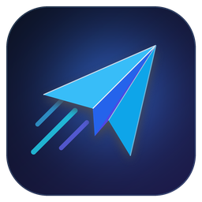

# Zephyr - A Modern Lightweight Desktop E-Mail Client
Developed by: **Houssem Benhacen**  
Repository: [https://github.com/houssembenhacen/Zephyr](https://github.com/houssembenhacen/Zephyr)

### 👁️‍🗨️ Summary
---

A standalone, modern lightweight e-mail client focused on achieving:

- **Resource Efficiency** - Minimal CPU, RAM, and battery consumption
- **Modern UX** - Clean, intuitive interface with dark mode and customizable density
- **Keyboard & Mouse Friendly** - Full keyboard navigation with fast shortcuts
- **Privacy & Security First** - End-to-end OpenPGP & S/MIME, Trust-On-First-Use TLS, automatic remote image protection
- **Search That Works** - Instant local full-text search powered by SQLite FTS5 virtual tables
- **Multi-Account & Scheduling** - Unified inbox, folder management, plus built-in CalDAV/Google/Outlook Calendar and CardDAV Contacts

### 🖥 OS Support
---

- Windows (x64)
- macOS
- Linux (Flatpak & Native)

### 🪶 Features
---

- **Multiple Accounts & Unified Inbox** (Color Code Accounts, send-as aliases)
- **Email Providers Supported**:
    - Generic IMAP / SMTP
    - Google (Gmail / Google Workspace)
    - Microsoft 365 / Outlook.com
    - Yahoo Mail
    - Proton Mail (via Proton Bridge)
    - iCloud Mail
    - Fastmail, Mailfence, Murena, Mailbox.org, Zoho, AOL, GMX
- **Security & Encryption**:
    - OpenPGP keypairs with WKD and HKP key server lookup
    - S/MIME certificates with PKCS#12 import and TOFU certificate management
    - OS Keyring integration (Windows Credential Manager) with AES-256-GCM fallback
- **Rich Text & Signatures**:
    - Detachable WYSIWYG Composer with TipTap/ProseMirror
    - HTML and plain text signatures per identity
    - Spellcheck with multiple downloadable dictionaries
- **Calendar & Contacts**:
    - CalDAV, Google Calendar, and Microsoft Graph Calendar integration
    - CardDAV, Google People, and Microsoft Graph Contacts autocomplete
- **Local-First Sync Architecture**:
    - Offline draft composition and message caching
    - Background incremental sync and IMAP IDLE push notifications

### ⚗️ Tech Stack
---

Built with [Wails v2](https://wails.io) (Go backend) + [Svelte 5](https://svelte.dev/) + [Tailwind CSS](https://tailwindcss.com/) + pure-Go SQLite FTS5.

### 🛠️ Building from Source
---

1. Install Go (1.25+), Node.js (20+), and Wails CLI (`go install github.com/wailsapp/wails/v2/cmd/wails@latest`).
2. Copy `.env.example` to `.env` and configure your Google / Microsoft OAuth credentials (optional — can also be configured in Settings).
3. Build the frontend and desktop binary:
   ```bash
   cd frontend && npm install && npm run build && cd ..
   wails build -s -tags webkit2_41
   ```
4. To build the Windows NSIS installer (requires NSIS):
   ```bash
   wails build -s -tags webkit2_41 -nsis
   ```

### 📑 Terms of Use & Privacy Policy
---

- [Terms of Use](docs/TERMS.md)
- [Privacy Policy](docs/PRIVACY.md)

### 📄 License & Attribution
---

Licensed under the [Apache License 2.0](LICENSE).  
Copyright (c) 2026 Houssem Benhacen.  

